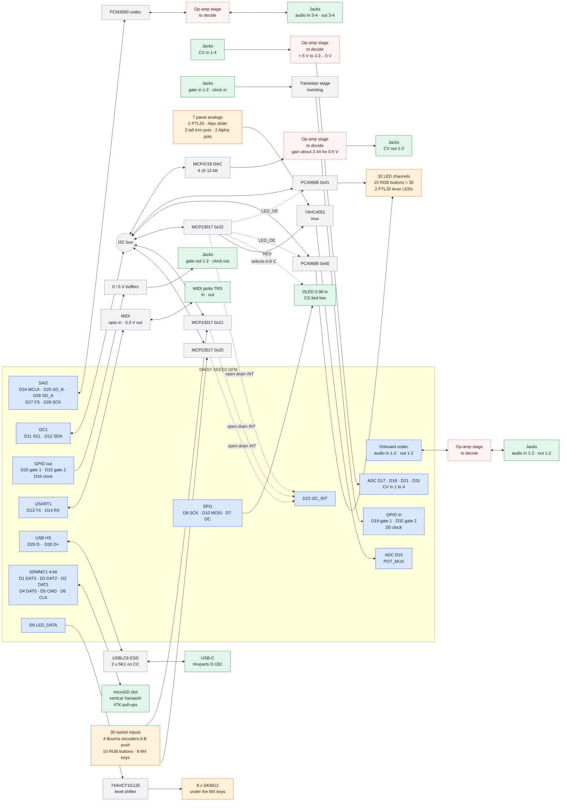
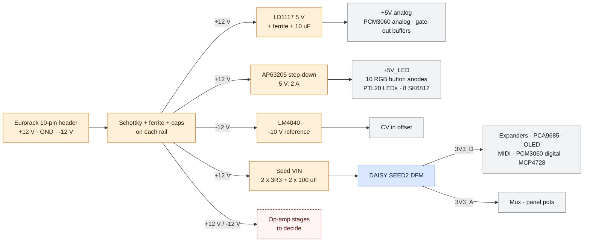

# Senario wiring map (2026-11-22)

What connects to the Daisy Seed2 DFM, as the spec stands (`spec-beta.md`). Mermaid: GitHub renders it, VS Code needs a Mermaid preview extension. **Dashed red boxes are decisions still open** (the op-amp stages). Nothing is built.

## Signals

Inputs enter from the left, outputs leave to the right. Orange = the controls and what they drive, green = what the player touches (jacks, USB-C, microSD, OLED), grey = chips.

## Power

